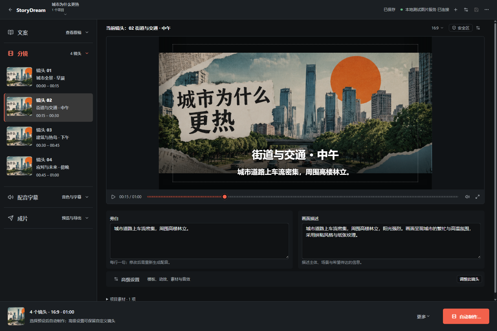

# Vox 生成流程减法设计与审查

更新：2026-10-23。范围：Vox 的生成入口、制作工作区、镜头编辑、任务反馈和一键成片契约。

## 结论

当前主要问题是把不同层级的决定放在同一个检查器：制作配方、渲染策略、模板或 AI 代码、镜头内容、素材、配音和导出。用户既需要学习内部实现，又需要自行判断生成顺序。减少控件数量只能缓解拥挤；必须同时统一项目主操作、按阶段展开编辑，并补齐自动任务链。

建议采用一个项目、两种操作深度：默认只需要文案、成片预设、画幅和自动旁白；需要细调时进入同一项目的制作步骤，逐阶段、逐镜头覆盖自动结果。固定底部操作条负责整片，局部操作明确标注“此镜头”。专家设置继续可达，但退出默认路径。

用户已选择第三张「制作大纲与就地编辑」作为实施基准。**阶段 A 的正式页面改造与界面验收已完成**：左侧四阶段/镜头大纲、中央预览与旁白/画面描述、按需高级抽屉、固定项目操作条。Vox 不再同时显示常驻右检查器和重复镜头胶片条，模板目录合并为一个入口；漫剧仍沿用原有导演台布局。

2026-10-23 已接入三个版本化制作预设、主进程持有的持久任务链、页面状态订阅和已保存生图响应的恢复。固定主入口为「自动制作…」：选择预设后启动，执行时可暂停，未知云端结果阻止重复提交；原有现有镜头渲染保留在更多操作内。应用保持打开时可以离开 Vox 页面继续执行；退出应用后不在后台继续生成，重新启动时先恢复记录并核对在途付费请求。

最新验证：9 文件 / 93 项聚焦 Vitest、renderer / Electron / scripts 三套 TypeScript 检查及生产构建通过；隔离 Electron 的 Vox 页面通过 85 项检查、保留 28 张截图；此前生产 Electron 漫剧定向回归 22 项、4 张截图通过。界面 QA 均无付费调用。**数据柱形图预设已通过真实完整自动链：19/19 节点完成，输出 23.88 秒、1080p 成片**。已验证切页继续、实际应用重启后复用请求结果，以及仅重做本地动画/渲染的修改路径。

完整样片：[NASA 年平均温度异常自动短片](I:/opc/.artifacts/vox-production-data/nasa-temperature-auto.mp4)。采用已保存的 NASA GISTEMP v4 数据，保留 0.39 / 0.72 / 1.01 / 1.28 ℃ 原值与出处。修正了重复入场、缓慢计数导致画面暂时显示错误事实的问题：只在首镜头简短揭示，后续镜头保持图表并按句级旁白高亮年份。完整解码、非静音、黑屏检查及 12 时点人工抽帧通过。原计划与四段真实配音共五个付费请求均只提交一次，本地修正未新增付费请求。

纸拼贴运行仍在 31 个节点完成后被一次无响应回执的生图请求阻塞，保留 unknown，未重提。此前两个完成镜头已用正式渲染器导出为 [23.46 秒、1080p 真实素材局部样片](I:/opc/.artifacts/vox-production-paper/saved-sample/urban-heat-partial.mp4)。人工抽帧发现第二镜头背景/主体重复、解释性动作不足，纸拼贴完整自动成片与成熟观感仍未通过。数据短片通过不代表所有预设成熟；地图和档案整片尚未验证。字幕及高亮按实测音频总时长估算句级时间，未做词级对齐或 VLM 审片。详情见 [实施验收](acceptance.md)；历史页面设计比较见 [设计 QA](design-qa.md)。

## 改造前页面的证据

使用当前实际 React 组件和 Vox runtime，在隔离 Electron 中通过模拟项目/API 捕获了 10 个状态。没有打开用户项目数据，没有调用生成服务。此方式用于检查布局、控件与操作层级，不等同于完整应用、真实模型或视频质量验收。

| 场景 | 检查器可滚动区域 | 内容高度 | 结论 |
| --- | ---: | ---: | --- |
| 1536×1024，本地拼贴 | 495px | 1257px | 配方、策略、内容占用同一长表单 |
| 1536×1024，动画模板 | 697px | 1107px | 更换模板有两个入口，整片生成仍为页脚小按钮 |
| 1536×1024，AI 动画 | 697px | 1180px | 代码生成与整片输出分属不同区域 |
| 1040×720，本地拼贴，深/浅色 | 191px | 1257px | 内容约为窗口区域的 6.58 倍，固定 Seed/按钮/空队列侵占编辑区 |
| 860×720，检查器抽屉 | 191px | 1257px | 抽屉改变了横向占位，但仍保留过长表单和较大固定底区 |

报告中各状态的页面横向溢出为 0，不能据此声称存在整页横向溢出。截图中的素材为空是模拟数据的预生成状态，不能据此判断真实生图失败。按钮几何数量包含滚动区域外元素，不代表同屏可见数量。

证据：

- [普通窗口](evidence/desktop-current.png)、[动画模板](evidence/desktop-template.png)、[AI 编辑底部](evidence/desktop-ai-bottom.png)。
- [紧凑深色](evidence/compact-current.png)、[紧凑浅色](evidence/compact-light.png)、[窄窗口抽屉](evidence/narrow-inspector.png)。
- [原始测量报告](evidence/report.json)、[构建日志](evidence/build.log)、[可复跑脚本](../../../scripts/qa-vox-design-audit.py)。

## 改造前按影响排序的问题

以下保留初始研究证据；行号与状态对应改造前工作树。阶段 A 已解决稳定操作位置、默认长表单、空队列占位、重复模板入口和按节点校验；阶段 B–D 已接通，数据柱形图整片已完成，其他预设的状态以本页开头及实施验收为准。

| 优先级 | 问题 | 可核对的位置 | 修改方向 |
| --- | --- | --- | --- |
| P0 | “一键成片”缺少完整动画任务链 | `director-batch.ts` 的能力仅含 image/video/voice/render，规划时排除 Remotion 的画面与视频节点 | 扩展持久化任务计划，覆盖分镜、资产、时间轴、动画、编译检查和成片验证 |
| P1 | 整片生成没有稳定的项目级位置 | `DirectorDeskWorkspace.tsx` 1713–1727：仅画面 tab 的检查器页脚含整片操作；Remotion 主位置只显示提示 | 将整片操作移到工作区底部，独立于 tab、镜头策略和滚动 |
| P1 | 新手被迫选择内部实现层 | `EditorialRecipeInspector`、渲染策略、`VoxAnimationEditor` 连续出现 | 项目预设解析成内部默认值；内部策略仅在高级设置覆盖 |
| P1 | 编辑空间被固定区域挤压 | 1040×720 实测 191px / 1257px | 空队列不占区，Seed 移至高级，任务反馈进入项目操作条/展开详情 |
| P1 | 批量工作依附页面生命周期 | `DirectorDeskWorkspace.tsx` 773–809：切项目/集或卸载时取消调度；恢复后暂停并要求核对远端 | 后台执行由应用服务持有；页面仅订阅状态，保持远端未知状态核对机制 |
| P2 | 模板入口重复、专业参数与内容同权重 | `VoxAnimationEditor.tsx` 的模板下拉和模板库按钮，后续颜色/导入/个人模板/镜头导出 | 保留一个模板入口；参数按 schema 与当前阶段显示，其余进高级 |
| P2 | 配置校验范围与实际计划不完全一致 | 工作区按 image/voice 勾选项判定缺服务；已有按 nodes 校验的 helper | 用实际待执行节点决定阻塞，避免不需要的服务阻断计划 |

行号对应本轮读取时的工作树，后续修改可能漂移。模板已对数字、地图、音频等字段做部分条件显示，不应把问题描述成“所有模板总是显示全部字段”。

## 完整目标与阶段 A 落点

1. 默认自动制作设置呈现三个结果导向的预设和旁白开关，复用项目文案与画幅。数据/地图要求来源，档案叙事要求导入资料、出处和许可。
2. 整片主操作固定在底部。生成中显示真实阶段，失败后只重试未完成部分，生成后提供播放与下载。
3. 项目设置与镜头编辑分开。默认镜头编辑只露出旁白、画面意图和当前内容；代码、Seed、引擎、颜色、GeoJSON 等通过明确入口展开。
4. 空队列收起；全量特效/模板目录只保留一个选择入口。自动制作默认选择匹配的表现手法，专家可以覆盖。
5. 保留同一份项目、镜头 ID、版本和手动锁定。切换操作深度不重新生成项目，不丢失编辑。

这些入口与计划契约已实现并做定向回归。自动规划保留创建流程已拆好的镜头 ID，补充标题和画面提示；动画节点按预设装配模板，锁定的自定义代码继续编译校验。这不等于新增任意 AI 分镜结构重写或自动生成动画代码能力。数据柱形图的完整成片已验收；纸拼贴、地图、档案叙事的真实整片与观感仍待验收。

## 设计图

三张图均以当前实际页面截图为参考，通过已配置 VllmProxy 的参考图编辑接口独立生成，实际尺寸均为 1536×1024，未本地放大。属于静态设计探索，图中文字、状态与数值不构成实现规格。

| 聊天展示顺序 | 方向 | 原图 | 主要取舍 |
| --- | --- | --- | --- |
| 1 | 预览优先、精简检查器 | [查看](concepts/preview-first/design.png) | 延续三栏工作区，改动较小；仍需消除重复镜头导航 |
| 2 | 从文案启动自动制作 | [查看](concepts/guided-production/design.png) | 新手路径最清楚；首次输入后仍需进入同项目的检查/编辑状态 |
| 3 | 制作大纲与就地编辑 | [查看](concepts/process-outline/design.png) | 取消常驻右栏，阶段与镜头集中导航；适合后续精调，需要紧凑窗口的纵向适配 |

实施选用第三种方向；没有将三张图拼成并行工作台。预览保留项目真实画幅及字幕，不照抄参考图中约 2.35:1 的静态画面，也不复制「自动」标签、误字或未经实现的一键承诺。

## GitHub 依据与交付索引

实际核对了 Impeccable、Anthropic frontend-design、UI UX Pro Max、Vercel 设计审查技能及其规则源。采用的是单一主操作、逐步展开、具体动作措辞、焦点/滚动/长内容处理；没有换装新的 UI 库。上述项目提供设计方法，不足以证明它们具备完整 Vox 自动生产能力。

- [GitHub 原文、固定版本与应用映射](github-design-references.md)
- [控件去留、预设、页面与按钮状态规格](interaction-spec.md)
- [实施依赖、组件拆分与真实样片验收](implementation-plan.md)
- [实施验收、完整数据短片、局部纸拼贴与未完成项](acceptance.md)
- [生图来源、同画布比较与设计 QA](design-qa.md)
- [执行记录](progress.md)

早期研究保留在 `evidence/`，最新界面证据在 `implementation-evidence/`；完整数据短片与恢复证据在 `I:/opc/.artifacts/vox-production-data/`，纸拼贴受阻记录与局部样片在 `I:/opc/.artifacts/vox-production-paper/`。高清长片资源基准、Vox 词级对齐与 VLM 审片、漫剧远程角色连续性/口型/完整上传下载断点恢复仍单列为未验证。
