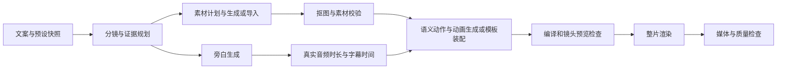

# 实施拆分与验收

状态：2026-10-23，按第三张 process-outline 推进。A 已完成；B 预设契约与 D 主进程调度已实现并通过定向验证；C/E 的数据柱形图真实完整链已通过，19/19 节点生成 23.88 秒 1080p 成片，并验证切页、重启复用和零新增付费的本地动画修正。纸拼贴在 31 节点后受未知生图请求阻塞，仅有 23.46 秒局部样片；地图/档案整片仍待验收。代码检查不替代媒体和观感验收。证据见 [acceptance.md](acceptance.md)。

## 阶段 A：固定主操作与版面减法

已完成。先让现有操作位置明确，不把未完成的自动链包装成可用功能。

- `DirectorDeskWorkspace.tsx`：提取项目操作区与主操作状态解析；整片生成退出检查器页脚，不受 `inspectorTab === generate` 与 Remotion 分支控制。
- 为 Vox 提供明确的工作区组合方式；共享结构使用有类型的能力/slots，避免在漫剧页扩散大量 `mode === vox` 判断。
- `VoxAnimationEditor.tsx`：拆分镜头内容、模板入口、动画高级。保留现有草稿冲突保护、取消、校验和素材稳定 ID；合并两个模板选择入口。
- `EditorialRecipeInspector.tsx` / `DirectorMotionInspector.tsx`：默认由预设决定，完整配方、渲染策略与动效目录迁入镜头高级入口。
- `director-desk.css` / Vox 自有样式：独立滚动、底部网格行、紧凑高度策略；空队列不占常驻区域。
- 新 UI 使用 `src/ui`，缺能力时扩展共享组件；禁止新功能页直接引入 Fluent/原生输入控件或第二套主题。

实际实现边界：`VoxProcessOutline` 管理导航投影，`voxProjectAction` 解析当前能力下的主按钮，`DirectorDeskWorkspace` 以 `process-outline` 组合预览/就地编辑/操作条并复用原检查器；`src/ui/Drawer` 提供保留草稿的模态抽屉与焦点管理。未为每组静态 JSX 创建额外状态组件。旁白更新复用 `setDirectorShotNarration`，不持有第二份业务真相。

验收：所有阶段与镜头策略下主操作可达；1536×1024 / 1040×720 深浅色、860×720 抽屉均可编辑到底；无空队列挤占、焦点遮挡、重复模板入口。阶段 A 当时仅提供「生成现有镜头成片」；现已接入任务链，主操作为「自动制作…」，明确要求确认设置，并投影真实进度与阻塞，不显示未经验证的完成承诺。

最新通过：9 文件 / 93 项聚焦测试、三套 tsc、生产构建；Vox 85 项实际 Electron 检查 / 28 张截图；此前共享漫剧 22 项 / 4 张截图。另覆盖三个预设的输入条件、100 镜头、长标题、200% 实际 Electron 缩放、保存重载、抽屉草稿与嵌套模板 Escape/焦点返回。阶段 A 的全景与四组聚焦同画布复核已完成。没有将两个基线套件的不兼容旧断言计入通过范围。

## 阶段 B：预设与输入契约

状态：已实现并定向验证。`src/shared/vox-production.ts` 提供版本化设置、来源、镜头锁定、节点及运行解析；`VoxProductionDialog` 提供纸拼贴、数据/地图、档案叙事三个结果预设。数据/地图不创建生图节点；数据柱形图已用真实来源数据与配音完成整片。档案使用已导入图片和来源/许可，背景仍可能生成；地图和档案真实整片尚未执行。

- 设计结果导向的版本化 `VoxProductionPreset`；与当前 `EDITORIAL_RECIPES` 镜头配方分层。
- 解析器输出具体计划默认值、所需数据、模型/音色能力和覆盖字段。三个预设不能仅换标签/图片而执行同一泛化提示词。
- 与 `EditorialCollagePage.tsx` 当前文档、创建流程和 `editorial-recipes.ts` 接合；旧文档保留自定义值与原始动画 payload。
- 引用/数据必须可溯源；地图/数据预设缺输入提供修复或切换路径。
- 默认设置、局部覆盖和锁定必须有版本与作用范围；切换 UI 深度不重建项目。

验收：新手只处理文案、预设、画幅、旁白即可准备运行；旧项目重开无丢失；预设解析可重复；没有额外隐藏的引擎选择要求。

## 阶段 C：补齐真正的一键任务链

实施结果：新增 `electron/vox-production-service.ts` 和 `vox-production-runtime.ts`，采用 Vox 自有版本化依赖计划，复用现有图片、抠图、语音、编译、导演台渲染及质量检查边界，没有强行将新节点写进只有 image/video/voice/render 的旧批次序列化。通过 storage/main/preload/API 和历史活动接入正式项目。

边界：创建流程先生成初始镜头；自动计划保留这些镜头 ID，仅补充标题/画面提示。动画节点装配预设模板与语义 cue，并校验锁定的自定义代码，没有新增自动 AI 代码创作。数据运行完成 19/19 节点，编译、渲染及质量门控的成功路径已有完整真实成片；纸拼贴在 31 节点后阻塞。失败或未知付费结果不能进入完成状态。

### 目标依赖链

- 当前预设的动画节点装配有效 props 与素材；锁定的 AI 自定义代码沿用原有编译隔离与资产访问限制。新增自动 AI 代码生成尚未实现，不作为本轮交付。
- 复用 `electron/preload.ts`、`storydream-api.ts` 的现有信任边界与 IPC 验证；复用 `electron/director-renderer.ts` 和已有质量审查入口，不复制另一个渲染管线。
- 为 Vox 增加适配器，把文档/资产、真实旁白时间、语义 cue、动画产物投影到可持久化运行计划。对依赖失效使用指纹，而非 `Boolean(outputUrl)`。
- 自动生成用本次运行快照与选定模型/音色；晚到结果不能回写其他项目、镜头或较新的修订。
- 服务阻塞从实际计划节点导出，复用/扩展 `directorBatchUnavailableReasons` 的思路；没有图生视频节点时不要求视频服务。
- 编译/预览失败阻止进入最终成功状态，记录精确镜头；修复策略有上限且保存成本，不无限自动付费重试。
- 新计划持久化包含版本、上限、未知节点及校验；旧项目/旧批次继续沿用各自解析路径，未将新运行伪装成旧批次。

验收：从原始文案出发，未点局部生成按钮即可得到真实可播放成片；计划包含实际执行的动画节点；编译坏代码/缺素材/旁白失败等场景不能绕过依赖进入“已完成”。

## 阶段 D：让执行真正离开页面

实施结果：自动制作所有者为主进程服务，页面只订阅状态和发送控制请求。真实生产 Electron 已验证离开 Vox 页面继续执行、重新打开持久项目及复用同一请求 ID。旧手动批量仍保留原有生命周期；两者不是同一个调度器。

应用保持打开时可切页继续执行。关闭整个应用不会持续在云端自动完成后续步骤；重启恢复为暂停，已发出但无可靠结果的付费节点标为 unknown。同步响应的 URL/base64 和异步 task ID 先写请求专属回执，恢复仅下载/查询已有结果，不创建新的生成请求。当前旧失败请求发生在回执补丁之前，没有回执或 task ID，无法追溯恢复。

- 调度所有者改为应用/main-process 服务或已经存在且可扩展的通用应用服务；实施前检查其事件/持久化契约，选择复用接入，不先造平行运行时。
- UI 只订阅 `runId` 和稳定项目 ID 的状态、发出暂停/恢复/取消意图。关闭检查器或切页面不销毁任务。
- 并发提交去重；记录 provider job ID 与请求指纹；重启后优先查询远端状态。未知结果保留为待核对，不能盲目创建重复收费请求。
- 暂停停止派发新节点，在途任务的结果继续持久化；取消真实调用对应能力。没有远端取消接口就明确呈现其限制。
- 节点失败后只修复/重试失败与失效依赖；保留成功、导入和用户锁定内容。暂停/失败后的主操作均由运行状态投影决定。

验收：切页面、切项目、应用重启、断网和晚到结果均有明确表现；同一未知远端任务不会因恢复按钮而重复提交；切换项目不污染草稿。

## 阶段 E：真实样片与界面回归

当前证据：数据柱形图的实际 4 镜头、19 节点自动链完成，输出 [23.88 秒 1920×1080 MP4](I:/opc/.artifacts/vox-production-data/nasa-temperature-auto.mp4)。NASA 来源数值为 0.39 / 0.72 / 1.01 / 1.28 ℃。已修复舍入精度、负数基线、每镜重复入场和中间计数；首镜短暂揭示，后续保持图表，按估算句级 cue 高亮年份。完整解码、非静音、黑屏检查及 12 时点人工抽帧通过。离线本地修正复用全部 5 个付费请求的 ID/attempt，没有新增生成。

纸拼贴真实运行完成 31 个节点，`image:shot-3-b:shot-3-b-background` 在请求发出约 34 秒后 `fetch failed`，保留 unknown 阻止自动重提。仅复用前两个已完成镜头导出 23.46 秒 1080p MP4。人工抽帧发现背景/主体建筑重复与表达偏弱，未通过纸拼贴完整成片或成熟观感验收；地图与档案整片仍待执行。

| 验收项 | 输入与操作 | 必须留下的证据 |
| --- | --- | --- |
| 纸拼贴自动讲解 | 约 45–60 秒真实文案，城市热岛等明确主题；自动完成分镜/生图/抠图/配音/动画/成片 | 最终 MP4、制作快照、真实素材和音频、媒体检查报告、过程事件 |
| 数据/地图 | 带来源的实际数值与地点；缺数据也单独走一遍 | 数据关联、图表/地理正确性、缺输入修复路径；不能拿随机数字样例当事实 |
| 档案叙事 | 有出处的真实资料/许可素材，至少多个镜头 | 资料来源、引用对应、无伪造档案；动画可读 |
| 局部修改 | 改旁白、改强调色、替换图并锁定其中一镜头 | 受影响节点对比；不受影响的付费素材复用；锁定内容保留 |
| 失败与恢复 | 模型失败、编译失败、断网、重启、远端未知 | 错误可定位、恢复无重复收费提交、已完成产物保留 |
| 版面与可访问性 | 普通/紧凑/窄窗口、深浅色、200% 缩放、长标题/错误、键盘、减少动态效果 | 正式 Electron 截图与行为记录；主操作固定可达、无焦点遮挡 |

媒体通过条件：实际文件存在且可解码，有视频轨；启用旁白时有可解码音轨；时长与真实音频/镜头总时长在声明容差内；首中末与转场抽帧无黑帧/缺素材/明显裁切；字幕可读、主体/证据/结论跟随解释顺序；能直接播放整片。颜色块或只有字幕的测试只能作为渲染烟测，不算质量通过。

词级对齐只在真实来源提供词级时间时成立；句级/估算时长必须准确标注。若调用 VLM 审片，保存模型、输入抽帧、报告与修复记录；没有调用就列为未做，不能由编译通过替代。长片/高清内存基准独立记录分辨率、时长、素材数量、峰值 RSS、耗时及机器配置，本轮不宣称通过。

代码验证按实际改动选择：主操作状态/预设解析/依赖失效与迁移用聚焦测试；组件行为与共享导演台回归；`npm run typecheck`。共享组件、shell 或 provider 修改时执行生产构建。通过后再做真实媒体验收，不用重复无关全量测试掩盖媒体缺口。

## 发布门槛与顺序

按 A → B → C → D → E 推进。当前可声明数据柱形图完整自动链与基础媒体/人工抽帧验收通过，不能扩展为所有 Vox 预设成熟。「自动制作…」启动可观察、可暂停的制作任务，失败和未知结果如实呈现。后续继续处理纸拼贴素材重复和解释性动作；原未知请求仅在找回结果或取得无结果依据后恢复，另外完成地图/档案整片及语音/字幕精度验证。保留旧项目读取与导出路径，避免修改共享工作区时影响 AI 漫剧。
